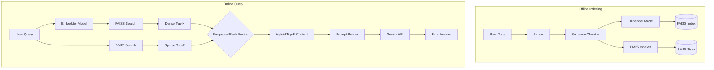

# HybridRAG: Technical Implementation Blueprint

**Project Name:** HybridRAG – Framework-Free Hybrid Information Retrieval Engine
**Role Context:** Senior ML Engineer & Information Retrieval Tech Lead
**Objective:** Provide a master technical specification for an AI agent to build a deeply defensible RAG pipeline from scratch (zero LangChain/LlamaIndex).

---

## 1. High-Level System Architecture
HybridRAG separates concerns into two distinct phases:
*   **Offline Pipeline (Indexing):** Ingests technical documentation, applies sentence-aware chunking, generates dense embeddings (Sentence Transformers), builds a sparse index (BM25), and builds a dense index (FAISS).
*   **Online Pipeline (Retrieval & Generation):** Accepts a user query, searches both indexes concurrently, fuses rankings via Reciprocal Rank Fusion (RRF), injects context into a prompt, and queries the Gemini API for a grounded response.

## 2. Folder Structure
```text
hybrid_rag/
├── data/
│   ├── raw/                 # Raw HTML/PDF docs
│   ├── processed/           # Parsed JSON lines (doc_id, text, metadata)
│   └── index/               # Saved FAISS index and BM25 pickles
├── config/
│   └── config.yaml          # Hyperparameters (chunk_size, RRF_k, model names)
├── src/
│   ├── __init__.py
│   ├── ingestion/
│   │   ├── parser.py        # HTML/Text extraction
│   │   └── chunker.py       # Sentence-aware sliding window
│   ├── indexing/
│   │   ├── embedder.py      # PyTorch SentenceTransformer wrapper
│   │   ├── faiss_store.py   # FAISS IndexFlatIP logic
│   │   └── bm25_store.py    # BM25 sparse index logic
│   ├── retrieval/
│   │   ├── ranker.py        # RRF algorithm implementation
│   │   └── hybrid_search.py # Orchestrates BM25 + FAISS + RRF
│   ├── generation/
│   │   ├── prompt_builder.py# Context formatting
│   │   └── llm_client.py    # Gemini API integration
│   └── evaluation/
│       └── evaluator.py     # Recall@K, MRR, Precision calculation
├── tests/                   # Unit tests for chunking and IR math
├── app.py                   # Streamlit UI
├── requirements.txt
└── README.md
```

## 3. Data Flow Diagram


## 4. End-to-End Pipeline
1.  **Scrape/Download:** PyTorch or Hugging Face docs as HTML/Markdown.
2.  **Parse:** Strip tags, extract raw text, preserve hierarchical metadata (e.g., Module -> Function).
3.  **Chunk:** Split into chunks of ~512 tokens using sentence boundaries and a 10% overlap.
4.  **Embed & Index:** Generate 384-dimensional vectors (using `all-MiniLM-L6-v2`); add to FAISS `IndexFlatIP`. Simultaneously build the BM25 term-frequency dictionary.
5.  **Query:** Embed the user query. Run L2/IP distance on FAISS. Run term-matching on BM25.
6.  **Fuse:** Apply $RRF\_Score = \frac{1}{k + rank_{dense}} + \frac{1}{k + rank_{sparse}}$.
7.  **Generate:** Prompt Gemini with: "Answer the query using ONLY the following context..."

## 5. Module-Wise Breakdown & 6. Python File Responsibilities
*   **`parser.py`:** Reads raw files (BeautifulSoup for HTML), outputs clean text.
*   **`chunker.py`:** Core logic for the sliding window algorithm.
*   **`embedder.py`:** Initializes `sentence-transformers`, handles batching for device (CPU/GPU).
*   **`faiss_store.py`:** Wraps `faiss.IndexFlatIP`. Handles adding vectors, saving to disk, and searching.
*   **`bm25_store.py`:** Wraps `rank_bm25` (or custom math). Handles tokenization, fitting, saving, and querying.
*   **`ranker.py`:** Pure math functions. Implements the RRF formula.
*   **`hybrid_search.py`:** The Facade pattern. Takes a query string, coordinates embedder, FAISS, BM25, and ranker to return the final list of dictionaries (chunk text, score, metadata).
*   **`prompt_builder.py`:** Templating engine string formatting.
*   **`llm_client.py`:** Gemini API REST/SDK calls with exponential backoff.
*   **`evaluator.py`:** Accepts a ground-truth dataset (Query -> Expected Doc ID) and calculates IR metrics.

## 7. Classes and Functions to Implement
*   `class SentenceSlidingWindowChunker`:
    *   `def __init__(self, max_tokens=500, overlap_tokens=50)`
    *   `def chunk_document(self, text: str) -> List[str]`
*   `class VectorStore`:
    *   `def build_index(self, embeddings: np.ndarray)`
    *   `def search(self, query_embedding: np.ndarray, top_k: int) -> Tuple[np.ndarray, np.ndarray]`
*   `class HybridRetriever`:
    *   `def retrieve(self, query: str, top_k: int) -> List[Dict]`
*   `def reciprocal_rank_fusion(dense_results: List[Tuple], sparse_results: List[Tuple], rrf_k=60) -> List[Tuple]`

## 8. Algorithms to Implement Manually
1.  **Sentence-Boundary Sliding Window:** Use `nltk.sent_tokenize` or regex `(?<=[.!?])\s+`. Accumulate sentences until `len(words) > max_tokens`. To slide the window, keep the last $N$ sentences from the previous chunk.
2.  **Cosine Similarity via Inner Product:** Ensure all dense vectors are L2-normalized `v = v / np.linalg.norm(v)` *before* adding to `FAISS IndexFlatIP`.
3.  **Reciprocal Rank Fusion (RRF):** An algorithm to combine ranked lists without needing normalized scores. It heavily weights items that appear near the top of *both* lists.

## 9. External Libraries and Justifications
*   `numpy`: For fast matrix operations and vector normalization.
*   `faiss-cpu`: Meta's industry-standard library for dense vector indexing. Proves knowledge of low-level C++ bindings for IR.
*   `sentence-transformers`: Local embedding generation without API network latency or cost.
*   `rank_bm25`: Lightweight, standard implementation of the Okapi BM25 sparse retrieval algorithm.
*   `google-generativeai`: For the Gemini generation step.
*   `streamlit`: For the rapid visual benchmarking UI.
*   `nltk`: For robust sentence tokenization.

## 10. Dataset Selection and Preprocessing
**Dataset:** PyTorch API documentation (or HuggingFace `transformers` docs).
*Why:* It contains dense code snippets, hyperparameter explanations, and mathematical formulas. This perfectly stresses a retriever (requires exact keyword matches for code, semantic matches for concepts).
*Preprocessing:* Remove HTML navbars, footers, and script tags. Extract code blocks specifically to ensure they aren't arbitrarily split.

## 11. Chunking Strategy
Avoid character-based splitting. Use **Semantic Sentence-Aware Chunking**.
1. Split document into a list of sentences.
2. Iteratively add sentences to a buffer.
3. If adding a sentence exceeds `max_tokens` (e.g., 384 tokens), yield the buffer as a chunk.
4. Start the new buffer with the last 2-3 sentences of the previous chunk (the overlap) to preserve context continuity.

## 12. Embedding Strategy
Use `all-MiniLM-L6-v2`. It outputs 384-dimensional vectors. It is fast, runs easily on a CPU, and is specifically trained for asymmetric semantic search (short queries retrieving long paragraphs).
*Crucial Step:* Embeddings must be L2 normalized prior to FAISS ingestion to use Inner Product as Cosine Similarity.

## 13. Retrieval Pipeline
Given a query $Q$:
1. $Q_{dense} = embed(Q)$. Search FAISS for Top-60 documents.
2. $Q_{sparse} = tokenize(Q)$. Search BM25 for Top-60 documents.
3. Both engines return a list of `(doc_id, score)`. Sort them by score to establish `rank`.

## 14. Hybrid Ranking Implementation (RRF)
Create a dictionary to track scores: `rrf_scores = defaultdict(float)`.
Iterate through the Dense ranked list (rank 1 to 60):
`rrf_scores[doc_id] += 1 / (60 + dense_rank)`
Iterate through the Sparse ranked list (rank 1 to 60):
`rrf_scores[doc_id] += 1 / (60 + sparse_rank)`
Sort the dictionary by value descending, and return the Top-K (e.g., Top 5).

## 15. Prompt Engineering Strategy
**Context-Augmented Generation.** 
```text
System: You are an expert PyTorch technical assistant. Use ONLY the provided retrieved context to answer the user's question. If the answer is not contained in the context, explicitly state "The retrieved documentation does not contain the answer." Do not use outside knowledge.

Context 1 (Relevance Score: 0.045):
{chunk_1}

Context 2 (Relevance Score: 0.038):
{chunk_2}

User Question: {query}
```

## 16. Evaluation Methodology
Create a manual "Golden Dataset" of 30-50 queries (e.g., "What are the parameters for torch.nn.Conv2d?"). For each query, map the exact `doc_id` or chunk that contains the answer.
Run the queries through the pipeline and evaluate the *Retrieval* step.

## 17. Metrics to Record
*   **Recall@5:** Out of 50 queries, how many times was the correct chunk in the Top 5 retrieved results?
*   **Mean Reciprocal Rank (MRR):** If the correct chunk is ranked 1st, score is 1. If 2nd, 0.5. If 3rd, 0.33. Average this across all queries. (A metric of how high up the correct answer is).
*   **Dense vs Sparse vs Hybrid:** Record Recall@5 for FAISS alone, BM25 alone, and Hybrid RRF to mathematically prove the hybrid approach is superior.
*   **Latency:** Average time for Embedding + FAISS + BM25 + RRF (should be < 50ms).

## 18. Logging Strategy
Use Python's built-in `logging` library. 
*   `INFO` for system startup, index loading, and query execution times.
*   `DEBUG` for logging the raw tokens, raw RRF scores, and chunk lengths during processing.

## 19. Configuration Management
Use a `config.yaml` to decouple hyperparameters from code:
```yaml
chunking:
  max_tokens: 384
  overlap: 50
retrieval:
  top_k_fetch: 60
  top_k_final: 5
  rrf_k: 60
model:
  embedding: "all-MiniLM-L6-v2"
  llm: "gemini-1.5-flash"
```

## 20. Streamlit UI Design
A minimal, split-screen UI optimized for interview demos.
*   **Sidebar:** Sliders for `Top-K`, `RRF_k_constant`.
*   **Main Input:** Text box for query.
*   **Results Area (3 Columns):**
    *   Col 1: Top 3 BM25 Chunks (Sparse)
    *   Col 2: Top 3 FAISS Chunks (Dense)
    *   Col 3: Top 3 RRF Chunks (Hybrid)
*   **Bottom Section:** The final Gemini LLM Generated Response based on the Hybrid chunks.

## 21. GitHub Repository Structure
*   `README.md`: Highly technical, featuring architecture diagram, evaluation metrics (Recall@5 improvements), and run instructions.
*   `requirements.txt`: Locked dependencies.
*   `notebooks/`: A single Jupyter notebook demonstrating the `evaluator.py` running the 50 Golden Queries and plotting a bar chart of Dense vs Sparse vs Hybrid Recall.

## 22. Milestone-Wise Implementation Roadmap
*   **Milestone 1 (Days 1-2):** Data Ingestion & Custom Chunker. (Output: Clean `.jsonl` of chunks).
*   **Milestone 2 (Days 3-4):** Indexing. Embed chunks, save FAISS `.index` and BM25 `.pkl`.
*   **Milestone 3 (Days 5-6):** Retrieval Engine. Implement RRF and `hybrid_search.py`.
*   **Milestone 4 (Day 7):** Evaluation. Create the golden dataset and run `evaluator.py` to get the hard metrics.
*   **Milestone 5 (Days 8-9):** LLM integration & Streamlit UI construction.

## 23. Common Implementation Pitfalls
1.  **Vector Normalization Failure:** If using `IndexFlatIP` in FAISS, vectors *must* be L2 normalized. If not, longer documents artificially score higher.
2.  **BM25 Tokenizer Mismatch:** The tokenizer used to build the BM25 index must be the exact same one used on the user query at runtime.
3.  **Context Bloat:** Passing too many chunks to Gemini dilutes attention ("Lost in the Middle" phenomenon). Stick to Top 3–5 high-quality chunks.
4.  **Index Alignment:** The integer ID returned by FAISS and BM25 must map exactly to the same index in your chunk metadata store.

## 24. Future Improvements (Post-MVP)
1.  **Cross-Encoder Re-Ranking:** Replacing RRF with a neural Cross-Encoder (e.g., `ms-marco-MiniLM-L-6-v2`) for state-of-the-art semantic reranking.
2.  **Hierarchical Navigable Small World (HNSW):** Upgrading `IndexFlatIP` to `IndexHNSWFlat` for logarithmic scale searching if the document corpus scales > 1,000,000 chunks.
3.  **FastAPI Microservices:** Separating the retrieval engine into a FastAPI microservice and the UI into a distinct frontend container.
