# HybridRAG: Framework-Free Hybrid Information Retrieval Engine

[](https://www.python.org/)
[](https://github.com/facebookresearch/faiss)
[](https://pypi.org/project/rank-bm25/)
[-success.svg)](#)

**HybridRAG** is a production-grade, **framework-free** Retrieval-Augmented Generation (RAG) and Information Retrieval (IR) engine built from first principles in Python and NumPy (**zero LangChain / LlamaIndex wrappers**).

Designed around **PyTorch technical API documentation**, HybridRAG combines:
1. **Sparse Lexical Retrieval (Okapi BM25)** with custom identifier/camelCase/snake_case tokenization for exact API signatures, parameters, and environment flags (`torch.nn.Conv2d`, `eps=1e-05`, `CUBLAS_WORKSPACE_CONFIG=:4096:8`).
2. **Dense Semantic Vector Search (`faiss.IndexFlatIP` + `all-MiniLM-L6-v2`)** with strict L2 vector normalization for exact Cosine Similarity over natural-language conceptual queries.
3. **Reciprocal Rank Fusion (RRF)** to merge heterogeneous rankings without score calibration fragility.
4. **Strictly Grounded Gemini Generation (`google-genai` / `gemini-2.5-flash`)** with exponential backoff and citation enforcement.

---

## 1. System Architecture

```mermaid
flowchart TD
    subgraph Offline ["Offline Indexing Pipeline"]
        A["Raw PyTorch HTML Docs"] --> B["HTMLDocParser (BeautifulSoup)"]
        B --> C["SentenceSlidingWindowChunker\n(Code-Aware + Header Injection)"]
        C --> D["DenseEmbedder (all-MiniLM-L6-v2)\n+ Explicit L2 Normalization"]
        C --> E["BM25Store\n(Technical Tokenizer + BM25Okapi)"]
        D --> F[("FAISS IndexFlatIP\n(.index)")]
        E --> G[("BM25 Pickle Store\n(.pkl)")]
    end

    subgraph Online ["Online Retrieval & Grounded Generation"]
        Q["User Technical Query"] --> H["Dense Query Embedder (L2-Norm)"]
        Q --> I["Technical Tokenizer"]
        H --> J["FAISS Cosine Search (Top-60)"]
        I --> K["BM25 Lexical Search (Top-60)"]
        J & K --> L{"Reciprocal Rank Fusion (RRF)\n1/(k + rank_dense) + 1/(k + rank_sparse)"}
        L --> M["Top-K Hybrid Context Chunks"]
        M --> N["PromptBuilder (Strict Grounding)"]
        N --> O["Gemini 2.5 Flash Client"]
        O --> P["Grounded Technical Answer"]
    end
```



---

## 2. Empirical Benchmark Results (40-Query Golden Dataset)

Evaluated via `src/evaluation/evaluator.py` across **40 ground-truth PyTorch technical queries** (`data/evaluation/golden_queries.json`) spanning exact lexical identifiers, conceptual paraphrases, and hybrid architectural questions:

| Retrieval Engine | Recall@1 | Recall@3 | Recall@5 | MRR (Mean Reciprocal Rank) | Precision@5 |
| :--- | :---: | :---: | :---: | :---: | :---: |
| **Sparse Only (Okapi BM25)** | 87.50% | 97.50% | 97.50% | `0.9250` | `0.1950` |
| **Dense Only (FAISS `IndexFlatIP`)** | 85.00% | 92.50% | 95.00% | `0.8821` | `0.1900` |
| **Hybrid (BM25 + FAISS + RRF, $k=60$)** | **87.50%** | **97.50%** | **100.00%** | **`0.9271`** | **`0.2000`** |

### Latency Performance (CPU — `all-MiniLM-L6-v2` + FAISS + BM25 + RRF)
* **Mean End-to-End Retrieval Latency:** `9.18 ms` *(Target: `< 50.0 ms`)*
* **Median Latency (P50):** `8.99 ms`
* **95th Percentile Latency (P95):** `10.98 ms`

### Why Hybrid RRF Wins Empirically
* **Rescuing Dense Blind Spots:** On exact hyperparameter queries like `div_factor=25.0 final_div_factor=10000.0` (`Q15`) or `add_bias_kv=False add_zero_attn=False` (`Q04`), dense embeddings miss Top-5 (`Recall@5 = 0`), while BM25 ranks the exact section `#1`, allowing RRF to pull the ground-truth chunk into the Top-3.
* **Rescuing Sparse Blind Spots:** On natural-language conceptual paraphrases with zero exact keyword overlap like *"How to prevent unstable derivative explosions in deep sequence models by capping vector magnitude?"* (`Q22`), BM25 misses Top-5 (`Recall@5 = 0`), while FAISS Dense ranks `clip_grad_norm_` `#1`, allowing RRF to rescue it into Top-5.
* **Consensus Rank Boosting:** On queries like *"Speeding up neural network matrix multiplications on Tensor Cores using half-precision floating point"* (`Q23`), BM25 ranks `autocast` `#2` and FAISS ranks it `#4`, but because it ranks near the top of **both** lists, RRF promotes it to **Rank `#1`**.

---

## 3. Core Algorithms & Engineering Guardrails Implemented From Scratch

### 1. Code-Aware Sentence Sliding Window Chunker (`src/ingestion/chunker.py`)
* **256-Token Window Alignment:** `all-MiniLM-L6-v2` has a hard maximum sequence length of **256 WordPiece tokens** (~190 words). Chunks are capped at `max_tokens: 190` with `overlap_tokens: 35` so embeddings never silently truncate trailing text.
* **Atomic Code Block Preservation:** `<pre><code>` elements are converted into fenced ` ```python ... ``` ` blocks and isolated prior to sentence splitting so dotted API calls (`torch.nn.Conv2d`) and scientific notation (`eps=1e-05`) are never sliced mid-expression.
* **Contextual Header Injection:** Every chunk is prefixed with its hierarchical path (`[Module: torch.nn | Symbol: Conv2d | Section: shape_and_depthwise_math]`) before indexing.

### 2. Exact Cosine Similarity via L2-Normalized `faiss.IndexFlatIP` (`src/indexing/`)
All document and query embeddings are explicitly L2-normalized along the feature axis prior to entering `faiss.IndexFlatIP`:

$$\hat{\mathbf{v}} = \frac{\mathbf{v}}{\max(\|\mathbf{v}\|_2, \epsilon)}, \quad \text{Cosine}(\mathbf{q}, \mathbf{d}) = \langle \hat{\mathbf{q}}, \hat{\mathbf{d}} \rangle$$

### 3. Technical Identifier Tokenization for Okapi BM25 (`src/indexing/bm25_store.py`)
Both offline indexing and online search share `technical_tokenize()`, which preserves full dotted/assigned identifiers while expanding `camelCase` and `snake_case` sub-tokens:
```text
"torch.nn.Conv2d(eps=1e-05)" -> ["torch.nn.conv2d", "torch", "nn", "conv2d", "conv", "2d", "eps=1e-05", "eps", "1e-05"]
```

### 4. Reciprocal Rank Fusion (`src/retrieval/ranker.py`)
Combines dense and sparse rankings without fragile min-max score normalization:

$$\text{RRF\_Score}(d \in D) = \frac{1}{k + \text{rank}_{\text{dense}}(d)} + \frac{1}{k + \text{rank}_{\text{sparse}}(d)}, \quad k = 60$$

---

## 4. Repository Structure

```text
HybridRAG-Framework-Free-Hybrid-Information-Retrieval-Engine/
├── config/
│   └── config.yaml                     # Decoupled hyperparameters & file paths
├── data/
│   ├── raw/                            # 18 Sphinx-style PyTorch technical HTML docs
│   ├── processed/
│   │   └── chunks.jsonl                # Parsed & sentence-chunked JSONL corpus
│   ├── index/
│   │   ├── faiss_flatip.index          # Persisted FAISS IndexFlatIP vectors
│   │   ├── bm25_store.pkl              # Persisted BM25Okapi sparse index
│   │   └── chunk_metadata.json         # Aligned 0..N-1 integer ID metadata store
│   └── evaluation/
│       ├── golden_queries.json         # 40-query ground-truth Golden Dataset
│       └── benchmark_results.json      # Recorded Recall@K, MRR, and Latency report
├── notebooks/
│   └── hybrid_rag_evaluation.ipynb     # Benchmark visualization & bar chart notebook
├── src/
│   ├── config.py                       # YAML configuration & logging loader
│   ├── ingestion/
│   │   ├── corpus_builder.py           # Raw PyTorch HTML corpus generator
│   │   ├── parser.py                   # BeautifulSoup HTML cleaner & section extractor
│   │   ├── chunker.py                  # SentenceSlidingWindowChunker implementation
│   │   └── pipeline.py                 # End-to-end ingestion CLI pipeline
│   ├── indexing/
│   │   ├── embedder.py                 # SentenceTransformer wrapper + L2 normalization
│   │   ├── faiss_store.py              # VectorStore wrapping faiss.IndexFlatIP
│   │   ├── bm25_store.py               # BM25Store + technical_tokenize()
│   │   └── index_builder.py            # Aligned FAISS + BM25 index builder
│   ├── retrieval/
│   │   ├── ranker.py                   # Reciprocal Rank Fusion (RRF) math
│   │   └── hybrid_search.py            # HybridRetriever facade
│   ├── generation/
│   │   ├── prompt_builder.py           # Strict context-grounded prompt builder
│   │   └── llm_client.py               # Gemini 2.5 Flash client with backoff & fallback
│   └── evaluation/
│       └── evaluator.py                # Recall@K, MRR, Precision@K, and Latency runner
├── tests/                              # 15 unit tests covering every module
├── app.py                              # 3-Column Streamlit visual comparison UI
├── requirements.txt
└── README.md
```

---

## 5. Quickstart & Execution Instructions

### 1. Install Dependencies
```bash
pip install -r requirements.txt
```

### 2. Run the Offline Ingestion & Dual Indexing Pipeline
```bash
# Step 1: Parse HTML docs in data/raw/ and generate sentence-chunked data/processed/chunks.jsonl
python -m src.ingestion.pipeline

# Step 2: Embed chunks and build aligned FAISS (.index) and BM25 (.pkl) stores in data/index/
python -m src.indexing.index_builder
```

### 3. Run the 40-Query IR Evaluation Benchmark
```bash
python -m src.evaluation.evaluator
```

### 4. Run the Unit Test Suite
```bash
pytest -v
```

### 5. Launch the 3-Column Interactive Streamlit UI
```bash
# Optional: set GEMINI_API_KEY for live Gemini 2.5 Flash generation (or enter it in the UI sidebar)
export GEMINI_API_KEY="your-api-key"
streamlit run app.py
```

